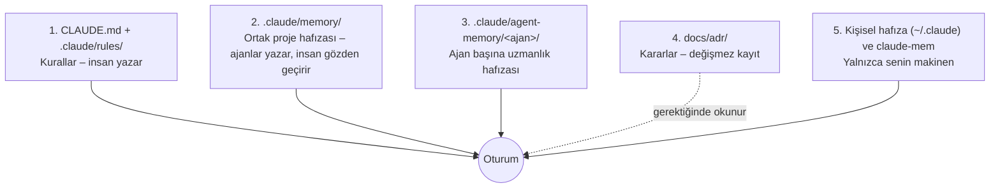

# Ajan Hafıza Sistemi

Her Claude Code oturumu boş bir bağlamla başlar. Hafıza sistemi, oturumlar ve ajanlar arasında bilginin
nasıl taşındığını belirler. Bu depoda hafıza **dosya tabanlıdır**: veritabanı, sunucu ya da dış servis yok.
Git ile sürümlenir, gözden geçirilebilir, herkes okuyabilir.

## 1. Beş katman

| Katman | Yer | Kim yazar | Git'te mi | Ne zaman yüklenir | Ne tutar |
|---|---|---|---|---|---|
| 1 | `CLAUDE.md`, `.claude/rules/` | Sen | Evet | Her oturum / eşleşen dosyada | Değişmeyen kurallar, komutlar |
| 2 | `.claude/memory/` | Ajanlar (`/remember`) | Evet | Dizin her oturumda; dosyalar gerektiğinde | Durum, dersler, sözlük, açık sorular, devir notları |
| 3 | `.claude/agent-memory/<ajan>/` | O ajan | Evet | O ajan her çalıştığında | Ajanın kendi alanında öğrendikleri |
| 3b | `.claude/agent-memory-local/tech-mentor/` | `tech-mentor` | **Hayır** | Mentor çalıştığında | Senin öğrenme ilerlemen (kişisel) |
| 4 | `docs/adr/` | `solution-architect`, sen | Evet | İlgili alanda çalışırken | Mimari kararlar ve gerekçeleri |
| 5 | `~/.claude/projects/...`, claude-mem | Claude (otomatik) | Hayır | Her oturum | Senin tercihlerin, kişisel notlar |

## 2. Ortak hafızanın dosyaları

| Dosya | İçerik | Örnek |
|---|---|---|
| `MEMORY.md` | Dizin. `CLAUDE.md` içinden içe aktarılır, bu yüzden **her oturumda bağlamdadır**. 150 satırın altında tutulur. | "Docker yığını hiç çalıştırılmadı" |
| `project-state.md` | Ne yapıldı, ne doğrulanmadı, sırada ne var | "28 test geçiyor; IT'ler hiç çalışmadı" |
| `lessons.md` | Zaman kaybettiren tuzaklar ve doğrulanmış teknik bilgiler | "Boot 4'te Jackson paketi `tools.jackson`" |
| `glossary.md` | Terimlerin bu projedeki anlamı | "Telafi: iş düzeyinde geri alma, rollback değil" |
| `open-questions.md` | Karar bekleyen konular ve kimin karar vereceği | "Eureka mı Kubernetes DNS mi?" |
| `handoffs/` | Oturum devir notları | `2026-11-20-sepet-servisi.md` |

## 3. Yazma protokolü

**Ne zaman yazılır**

- Koddan okunamayacak bir şey öğrenildiğinde (neden, tuzak, doğrulanmış sürüm).
- Bir iş dilimi bittiğinde ya da durum değiştiğinde (`project-state.md`).
- Oturum bitmeden iş yarım kaldığında (`/handoff`).
- Sen "bunu hatırla" dediğinde (`/remember`).

**Ne yazılmaz**

- Kodun ya da git geçmişinin zaten söylediği şeyler.
- Emin olunmayan tahminler (yazılacaksa `unverified` etiketiyle).
- **Sır, token, kişisel veri, makineye özgü yol.** Ortak hafıza herkese açık depoya gider.
- Mimari kararlar: onlar ADR'dir. Hafızaya yalnızca işaretçi konur.

**Nasıl yazılır**

- Girdi başına tek bilgi, tarihli (`YYYY-AA-GG`), nasıl doğrulandığı belirtilerek.
- Önce var olan girdi aranır; varsa güncellenir, kopya açılmaz.
- Yanlış çıkan girdi **silinir**. Bayat hafıza, hafızasızlıktan kötüdür.

## 4. Okuma protokolü: hafıza iddiadır, gerçek değildir

Hafızadaki her satır "yazıldığı gün doğruydu" demektir. Bir dosya, sınıf ya da ayar adı geçiyorsa ajan
harekete geçmeden önce kodda hâlâ var olduğunu kontrol eder. Hafıza ile kod çelişirse **kod kazanır** ve
hafıza düzeltilir.

## 5. Ajan başına hafıza nasıl çalışır

Bir ajanın tanım dosyasında `memory: project` varsa Claude Code o ajana `.claude/agent-memory/<ajan>/`
klasörünü verir ve oradaki `MEMORY.md` dosyasının ilk 200 satırını (ya da 25 KB) ajanın sistem istemine
ekler. Ajan çalıştıkça bu klasöre yazar; örneğin `code-reviewer` tekrar eden hata kalıplarını, `test-engineer`
kırılgan testleri kaydeder. Klasörler ilk yazmada oluşur; şu an boştur.

Neden ayrı: inceleyicinin bildiği ile mimarın bildiği farklıdır. Hepsini tek dosyaya koymak her ajanın
bağlamını ilgisiz bilgiyle doldurur.

`tech-mentor` bilerek `memory: local` kullanır: senin hangi konuda zorlandığın depoya girmez.

## 6. Bakım

Hafıza büyüdükçe değeri düşer. Ayda bir (ya da bir faz bitince):

1. `lessons.md` içinde artık geçerli olmayanları sil (sürüm yükseltildi, sorun çözüldü).
2. `project-state.md` dosyasını gerçek durumla eşitle.
3. `open-questions.md` içinde karara bağlananları ADR'ye taşı ve satırı sil.
4. Son üçten eski devir notlarını sil.
5. `MEMORY.md` 150 satırı geçtiyse ayrıntıyı alt dosyalara taşı.

Hafıza değişiklikleri de kod gibi PR'da gözden geçirilir: yanlış bir "ders" sonraki her oturumu yanıltır.

## 7. claude-mem ile ilişkisi

claude-mem, oturumlarını otomatik gözlemleyip yerel bir veritabanında saklayan ayrı bir eklentidir (katman
5). Kişiseldir ve depoya girmez. Bu depodaki dosya tabanlı hafıza ise ekibe aittir. İkisi çakışmaz:
claude-mem "geçen hafta ne yapmıştım?" sorusunu, ortak hafıza "bu projede herkesin bilmesi gereken ne?"
sorusunu cevaplar.
