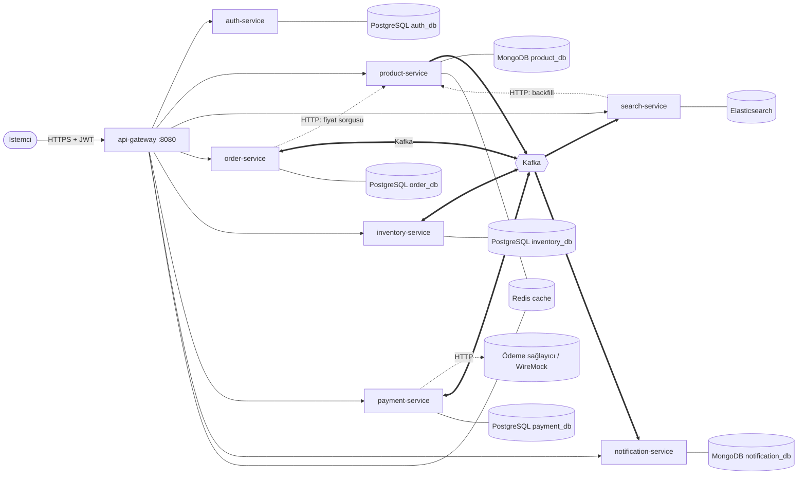
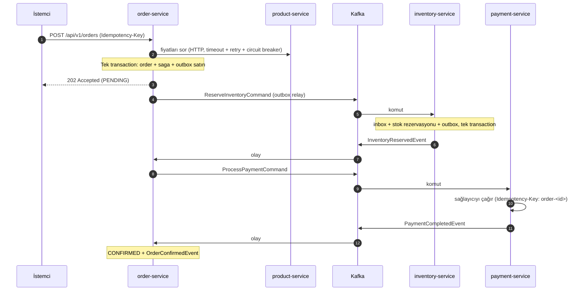
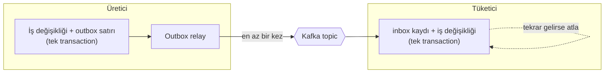

# Mimari Genel Bakış (bugünkü durum)

Bu belge kodda **şu an var olanı** anlatır. Gerçek bir e-ticaret platformuna göre eksikler ve hedef tasarım
[02-hedef-mimari.md](02-hedef-mimari.md) dosyasındadır.

## 1. Büyük resim

Okuma kılavuzu: düz ok senkron HTTP çağrısıdır, kalın ok Kafka mesajıdır. Senkron ok sayısının azlığı
bilinçli bir tercihtir; her senkron ok bir **çalışma zamanı bağımlılığıdır** (karşı taraf çökerse sen de
etkilenirsin).

## 2. Servisler ve veri sahipliği

| Servis | Sahip olduğu veri | Veritabanı | Neden bu veritabanı |
|---|---|---|---|
| auth-service | Kullanıcı hesapları, roller | PostgreSQL | İlişkisel, güçlü tutarlılık |
| product-service | Ürün kataloğu | MongoDB + Redis | Ürün özellikleri kategoriye göre değişir (esnek şema); okuma ağırlıklı, önbellek uygun |
| inventory-service | Stok, rezervasyonlar | PostgreSQL | Stok düşümü satır kilidi ve transaction ister (`FOR UPDATE`, PL/pgSQL) |
| order-service | Sipariş, saga durumu | PostgreSQL | Para ve durum makinesi: ACID şart |
| payment-service | Ödeme kayıtları | PostgreSQL | Aynı sebep |
| notification-service | Gönderilen bildirimler | MongoDB | Ekleme ağırlıklı, şemasız log benzeri veri |
| search-service | Arama indeksi (türetilmiş veri) | Elasticsearch | Tam metin arama, facet, öneri |

Kural: bir servis başka servisin veritabanına **asla** bağlanmaz ([ADR-0001](../adr/0001-servis-basina-veritabani.md)).
`search-service` verinin sahibi değildir; indeks silinse bile olaylardan ve `/internal/products/export`
uç noktasından yeniden kurulabilir.

## 3. Sipariş akışı (saga)

Başarısızlık yolları:

| Ne oldu | Saga ne yapar |
|---|---|
| Stok yetersiz | Sipariş iptal. Telafi gerekmez, çünkü ilk adım başarısız oldu. |
| Ödeme reddedildi | `ReleaseInventoryCommand` (telafi) → stok serbest → sipariş iptal. |
| Stok servisi cevap vermedi | Zaman aşımında telafi başlatılır. Serbest bırakma idempotent olduğu için güvenli. |
| Ödeme servisi cevap vermedi | **Başarısız sayılmaz** (müşteriden para çekilmiş olabilir). Komut tekrar gönderilir; `maxPaymentRetries` sonunda saga `STUCK` olur ve alarm çalar. |
| Ödeme, iptalden sonra tamamlandı | `ecommerce_saga_late_payments_total` artar, alarm çalar. İade akışı henüz yok ([yol haritası](../roadmap.md)). |

Kod: [OrderSagaOrchestrator.java](../../services/order-service/src/main/java/com/ecommerce/order/saga/OrderSagaOrchestrator.java).
Karar: [ADR-0002](../adr/0002-saga-orkestrasyon.md).

## 4. Güvenilir mesajlaşmanın üç parçası

1. **Outbox**: Veritabanına yazmak ve Kafka'ya göndermek iki ayrı sistemdir, ikisi birden atomik olamaz.
   Mesaj önce aynı transaction içinde bir tabloya yazılır, sonra ayrı bir süreç Kafka'ya taşır
   ([ADR-0003](../adr/0003-transactional-outbox.md)).
2. **En az bir kez teslimat**: Relay, Kafka onayından sonra ama "gönderildi" işaretini yazmadan ölürse mesaj
   tekrar gider. Yani tekrarlar **kesindir**.
3. **Idempotent tüketici (inbox)**: Tüketici mesaj kimliğini iş değişikliğiyle aynı transaction'da kaydeder;
   aynı mesaj ikinci kez gelirse atlar ([ADR-0004](../adr/0004-idempotency.md)).

Bu üçü birlikte "etkide tam bir kez" (effectively-once) sonucunu verir.

## 5. Olay kataloğu

| Topic | Mesaj | Üreten | Tüketen | Anahtar |
|---|---|---|---|---|
| `inventory.commands` | `ReserveInventoryCommand`, `ReleaseInventoryCommand` | order | inventory | orderId |
| `inventory.events` | `InventoryReservedEvent`, `InventoryReservationFailedEvent`, `InventoryReleasedEvent` | inventory | order | orderId |
| `payment.commands` | `ProcessPaymentCommand` | order | payment | orderId |
| `payment.events` | `PaymentCompletedEvent`, `PaymentFailedEvent` | payment | order | orderId |
| `order.events` | `OrderConfirmedEvent`, `OrderCancelledEvent` | order | notification | orderId |
| `product.events` (compacted) | `ProductUpsertedEvent`, `ProductDeletedEvent` | product | search | productId |

Her topic 3 partition ile açılır; her birinin `.DLT` uzantılı ölü mektup topic'i vardır. Başarısız mesaj
üstel bekleme ile 4 kez denenir, sonra DLT'ye gider. Bozuk mesaj (`NonRetryableMessageException`) denenmeden
DLT'ye gider.

## 6. Okuma modeli (CQRS)

Ürün yazma tarafı MongoDB'dir, arama tarafı Elasticsearch'tür. İkisi `product.events` ile eşitlenir.
Sıra bozulmasına ve tekrarlara karşı koruma Elasticsearch'ün **external versioning** özelliğidir: her olay
ürünün sürüm numarasını taşır, eski sürüm 409 ile reddedilir. Karar: [ADR-0005](../adr/0005-arama-icin-cqrs.md).

## 7. Kenar ve güvenlik

- **Tek giriş**: yalnızca gateway dışarıya açıktır. `/internal/**` yolları hiç yönlendirilmez.
- **JWT**: `auth-service` üretir (HS256, 30 dk). Gateway ve her servis imzayı kendisi doğrular; servisler
  ağa değil token'a güvenir. Üretim için asimetrik anahtar önerisi: [ADR-0006](../adr/0006-jwt-ve-servisler-arasi-guven.md).
- **Hız sınırı**: Redis'te token bucket (saniyede 20, patlama 40). Sayaç Redis'te olduğu için gateway
  replikaları arasında ortaktır.
- **Dayanıklılık**: gateway'de circuit breaker + fallback; yalnızca GET istekleri yeniden denenir.

## 8. Yatay ölçekleme

| Bileşen | Nasıl ölçeklenir | Neden güvenli |
|---|---|---|
| HTTP servisleri | Replika ekle (`--scale`) | Durumsuz; oturum yok, kimlik JWT'de |
| Kafka tüketicileri | Replika ekle (partition sayısına kadar) | Aynı consumer group, partition'lar paylaşılır |
| Outbox relay | Her replikada çalışır | PostgreSQL `SKIP LOCKED`, Mongo'da kiralama (lease) |
| Saga zaman aşımı taraması | Her replikada çalışır | Satır kilidi ile aynı saga iki kez işlenmez |
| Idempotency | Redis ortak | Aynı anahtar hangi replikaya giderse gitsin tek sonuç |

## 9. Gözlemlenebilirlik

Log ve trace OTLP ile collector'a, oradan Elasticsearch ve Kibana'ya gider. Metrikleri Prometheus çeker,
Grafana gösterir. Ayrıntı: [infra/observability/README.md](../../infra/observability/README.md),
karar: [ADR-0007](../adr/0007-gozlemlenebilirlik-yigini.md).

## 10. Bilinen sınırlar

- Yığın Docker'da hiç çalıştırılmadı; yalnızca derleme ve birim testleri doğrulandı.
- Entegrasyon testleri (`*IT`) build'e bağlı değil.
- Sepet, fiyatlandırma, kargo, iade gibi gerçek e-ticaret alanları yok.
- CI/CD, Kubernetes, gizli bilgi yönetimi yok.

Tam liste ve sıralama: [roadmap.md](../roadmap.md).
