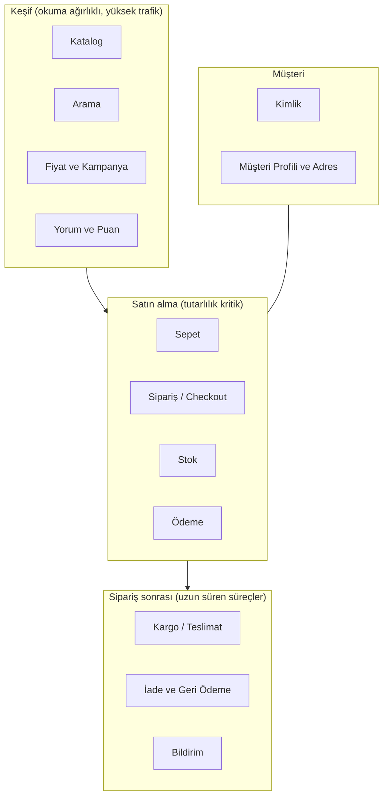

# Hedef Mimari (gerçek bir e-ticaret backend'i)

[01-genel-bakis.md](01-genel-bakis.md) bugünü anlatır. Bu belge **nereye gitmek istediğimizi** anlatır: orta
ölçekli gerçek bir e-ticaret şirketinin backend'inde bulunan alanlar, her birinin neden ayrı olduğu ve
bizim projede hangisinin eksik olduğu. Uygulama sırası [roadmap.md](../roadmap.md) dosyasındadır.

> Bu bir tasarım belgesidir. "Durum" sütununda "var" yazmayan hiçbir şey kodda yoktur.

## 1. Alanlar (bounded context)

Mimar olarak ilk işin servisleri değil **alanları** bulmaktır. Servis sınırı; verinin sahibi, değişim
sıklığı ve ekip sınırı ile belirlenir, teknolojiyle değil.

| Alan | Sorumluluk | Veri deposu | Tutarlılık | Durum |
|---|---|---|---|---|
| Kimlik | Kayıt, giriş, token, roller | PostgreSQL | Güçlü | **var** (refresh token, asimetrik anahtar yok) |
| Müşteri profili | Adresler, tercihler, KVKK onayları | PostgreSQL | Güçlü | yok |
| Katalog | Ürün, kategori, varyant, medya | MongoDB | Güçlü (yazma), olaylarla yayılır | **var** (varyant ve kategori ağacı yok) |
| Arama | Tam metin, facet, öneri | Elasticsearch | Nihai (saniyeler) | **var** |
| Fiyat ve kampanya | Liste fiyatı, indirim, kupon, vergi | PostgreSQL + Redis | Güçlü (fiyat anı sabitlenir) | yok (fiyat ürünün içinde) |
| Yorum ve puan | Yorum, moderasyon, ortalama puan | MongoDB | Nihai | yok |
| Sepet | Geçici sepet, misafir sepeti | Redis (TTL) | Oturum bazlı | yok |
| Sipariş | Sipariş yaşam döngüsü, saga | PostgreSQL | Güçlü + saga | **var** |
| Stok | Miktar, rezervasyon, depo | PostgreSQL | Güçlü (satır kilidi) | **var** (tek depo) |
| Ödeme | Tahsilat, iade, mutabakat | PostgreSQL | Güçlü + idempotent | **var** (iade ve webhook yok) |
| Kargo | Gönderi, takip, kargo firması entegrasyonu | PostgreSQL | Nihai, dış sisteme bağlı | yok |
| İade | İade talebi, geri ödeme sagası | PostgreSQL | Saga | yok |
| Bildirim | E-posta, SMS, push; şablonlar | MongoDB | Nihai, en az bir kez | **var** (yalnızca kayıt tutar, gerçek gönderim yok) |

## 2. Neden bu sınırlar

- **Sepet siparişten ayrıdır.** Sepet çok sık değişir, kaybolursa dünya yıkılmaz, Redis'te TTL ile durur.
  Sipariş ise para ve hukuki kayıttır. İkisini aynı tabloya koymak, en sık yazılan veriyi en değerli
  veriyle aynı kilide sokar.
- **Fiyat katalogdan ayrıdır.** Ürün açıklaması haftada bir değişir; fiyat ve kampanya saatte bir değişir
  ve farklı bir ekip (pazarlama) yönetir. Sipariş anında fiyat **sipariş satırına kopyalanır**; sonradan
  değişen fiyat eski siparişi etkilemez.
- **Stok katalogdan ayrıdır.** Stok güncellemesi yüksek frekanslı ve kilit gerektirir; katalog okuması
  önbelleklenir. Aynı belge üzerinde olsalar önbellek hep bayat olurdu.
- **Kargo ödemeden sonra başlayan ayrı bir süreçtir.** Günler sürer, dış sisteme (kargo firması) bağlıdır,
  webhook ile ilerler. Sipariş sagasını günlerce açık tutmak yerine ayrı bir süreç olarak modellenir.

## 3. İletişim kuralları

| Durum | Tercih | Örnek |
|---|---|---|
| "Bir şey oldu, ilgilenen ilgilensin" | Olay (Kafka) | `OrderConfirmedEvent` → bildirim, kargo |
| "Şunu yap ve sonucu bildir" (servisler arası süreç) | Komut + cevap olayı (saga) | `ReserveInventoryCommand` |
| Kullanıcı ekranda cevap bekliyor, veri başka serviste | Senkron HTTP + timeout + circuit breaker | Sipariş anında fiyat doğrulama |
| Aynı veri çok sık okunuyor | Olayla beslenen yerel kopya (read model) | Arama indeksi; sipariş servisinde ürün adı kopyası |

Hedefte ek olarak:

- **BFF (Backend for Frontend)**: web ve mobil için ayrı toplama katmanı. Ürün sayfası tek istekte katalog,
  fiyat, stok ve yorum özetini ister; bunu gateway'e iş mantığı koymadan çözer.
- **Şema kaydı (schema registry)**: sözleşmeler şu an `common-lib` içinde Java record. Ekip büyüyünce bu
  ortak kütüphane herkesin birlikte yayın yapmasını zorlar. Avro/Protobuf + registry bunu çözer.
- **CDC (Debezium)**: outbox tablosunu sorgulamak yerine veritabanı günlüğünü okur; gecikme ve yük azalır.

## 4. Platform katmanı (her şirkette karşına çıkar)

| Konu | Bugün | Hedef |
|---|---|---|
| Çalışma ortamı | docker-compose (tek makine) | Kubernetes + Helm, ortam başına values dosyası |
| Servis keşfi | Eureka | Kubernetes DNS (Eureka kaldırılır) ya da ikisi profil ile |
| Yapılandırma | Ortam değişkeni | ConfigMap + harici gizli bilgi deposu (Vault ya da bulut eşdeğeri) |
| CI | yok | GitHub Actions: derle, test, IT, imaj tara, yayınla |
| CD | yok | GitOps (Argo CD), canary ya da blue-green |
| Servisler arası güven | Ortak JWT sırrı (HS256) | RS256 + JWKS; servisler arası mTLS ya da client-credentials |
| API yönetimi | Elle yazılmış rotalar | OpenAPI sözleşmeleri, sürümleme politikası, tüketici sözleşme testleri |
| Dayanıklılık | resilience4j, DLT | + kaos testleri, yük testleri (k6/Gatling), geri basınç |
| Veri | Servis başına DB | + yedekleme/geri yükleme provası, okuma replikası, arşivleme |
| Gözlemlenebilirlik | Log, trace, metrik, alarm | + SLO ve hata bütçesi, runbook'lar, sentetik izleme |
| Güvenlik | JWT, hız sınırı | + bağımlılık ve imaj taraması, gizli bilgi taraması, denetim kaydı, KVKK silme akışı |

## 5. Kalite hedefleri (örnek, tartışmaya açık)

Mimari kararları "iyi" yapan şey bu hedeflerdir. Rakamlar şirketten şirkete değişir; önemli olan yazılı
olmalarıdır.

| Özellik | Hedef | Mimaride karşılığı |
|---|---|---|
| Ürün sayfası p95 | < 200 ms | Önbellek, read model, BFF |
| Sipariş oluşturma p95 | < 500 ms (202 dönüşü) | Asenkron saga, kısa transaction |
| Sipariş kaybı | Sıfır | Outbox, idempotency, DLT + alarm |
| Çift tahsilat | Sıfır | Idempotency-Key, inbox, sağlayıcı anahtarı |
| Erişilebilirlik | %99,9 (ayda ~43 dk) | Replika, circuit breaker, zarif bozulma |
| Arama tazeliği | < 5 sn | Olay tabanlı indeksleme |
| Kampanya günü | Normalin 10 katı trafik | Yatay ölçekleme, hız sınırı, kuyrukla tamponlama |

## 6. Kasıtlı olarak yapmayacaklarımız

Mimarlık neyi **yapmayacağını** seçmektir. Aşağıdakiler bu projede öğrenme değeri/karmaşıklık oranı düşük
olduğu için kapsam dışıdır; her biri için gerekçe ADR olarak yazılabilir.

- Event sourcing (her şeyi olay olarak saklamak): saga ve outbox çoğu şirketin ihtiyacını karşılar.
- Service mesh (Istio/Linkerd): mTLS ve trafik yönetimi kavram olarak anlatılır, kurulmaz.
- Çok bölgeli (multi-region) kurulum ve çok kiracılı (multi-tenant) yapı.
- Ön yüz. Bu bir backend projesidir.
