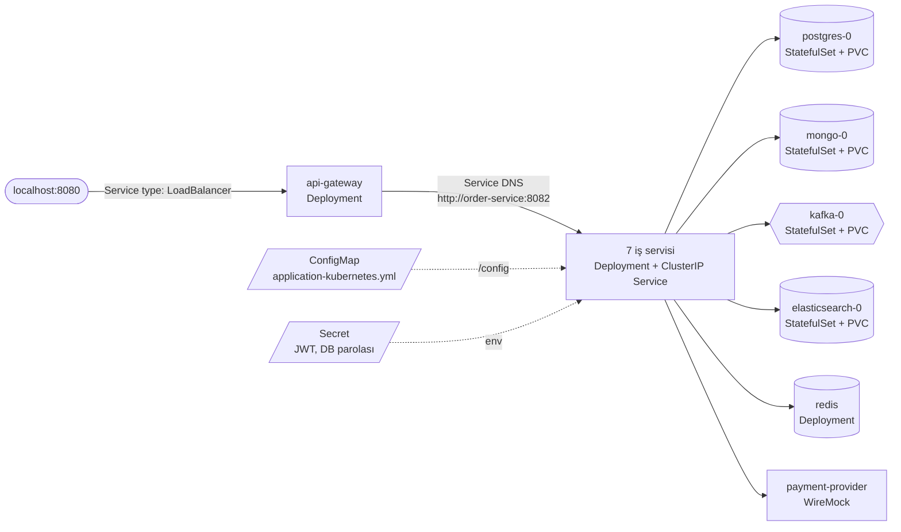

# Kubernetes'te Çalıştırma (yerel: Docker Desktop)

Aynı imajlar iki ortamda çalışır: docker-compose ve Kubernetes. Ortam farkı kodda değil, yapılandırmadadır.
Karar ve gerekçe: [ADR-0009](../adr/0009-kubernetes-servis-kesfi.md).

## 1. Ön koşullar

- Docker Desktop → Settings → Kubernetes → **Enable Kubernetes** (kubeadm, tek düğüm). Bağlam adı:
  `docker-desktop`.
- `brew install helm`
- Docker'a en az 8 GB bellek. Compose yığını ile Kubernetes **aynı anda sığmaz**. İkisi de `localhost:8080`
  portunu kullandığı için önce `make down` çalıştır.

## 2. Komutlar

```bash
make down          # compose yığınını durdur (veriler kalır)
make k8s-up        # imajları derle + helm upgrade --install (her şey hazır olana kadar bekler)
make k8s-status    # pod ve service listesi
make smoke         # aynı uçtan uca test, bu kez Kubernetes'e karşı
make console       # API konsolu: http://localhost:5500
make k8s-down      # chart'ı kaldır (PVC'ler kalır)
kubectl --context docker-desktop delete namespace ecommerce   # verilerle birlikte her şeyi sil
```

## 3. Kümede ne var



| Kubernetes nesnesi | Neden bu | Compose karşılığı |
|---|---|---|
| **Deployment** (servisler, Redis, WireMock) | Durumsuz; pod'lar birbirinin yerine geçebilir | `services:` + `deploy.replicas` |
| **StatefulSet** (PostgreSQL, Mongo, Kafka, ES) | Sabit ad (`mongo-0`) ve pod başına kalıcı disk | `volumes:` |
| **Service ClusterIP** | Sabit DNS adı + pod'lar arası yük dağıtımı | Docker ağı + Eureka |
| **Headless Service** (`clusterIP: None`) | Ad doğrudan pod IP'sine çözülür; veritabanları kendi adresini tanır | – |
| **Service LoadBalancer** (gateway) | Docker Desktop bunu `localhost:8080` adresinde açar | `ports: ["8080:8080"]` |
| **ConfigMap** | Ortama özgü ayar dosyası, imaja gömülmez | `environment:` |
| **Secret** | Parola ve anahtarlar ayrı nesnede; RBAC ile ayrıca korunabilir | `.env` |
| **initContainer** `wait-for-dependencies` | Kubernetes'te `depends_on` yok; bağımlılık açılana kadar bekler | `depends_on: service_healthy` |

## 4. Sağlık kontrolleri (probe)

Her Spring servisinde üç probe vardır ve her biri farklı bir soruyu cevaplar:

| Probe | Soru | Başarısız olursa | Uç nokta |
|---|---|---|---|
| startup | JVM açılışını bitirdi mi? | Diğer ikisi beklemeye devam eder; süre (180 sn) dolarsa yeniden başlatır | `/actuator/health/liveness` |
| liveness | Süreç takıldı mı? | Konteyneri **yeniden başlatır** | `/actuator/health/liveness` |
| readiness | Şu an trafik alabilir mi? | Pod'u Service'ten **çıkarır**, yeniden başlatmaz | `/actuator/health/readiness` |

Sık yapılan hata: liveness içine veritabanı kontrolü koymak. Veritabanı yavaşlayınca bütün pod'lar aynı anda
yeniden başlar ve sorun büyür. Dış bağımlılık kontrolü readiness'e aittir, liveness'e değil.

## 5. İlk kurulumda çıkan sorunlar (öğretici)

1. **Mongo replica set "tavuk-yumurta" sorunu.** Headless Service DNS'te yalnızca *hazır* pod'ları
   gösterir. Mongo replica set'i `mongo:27017` adıyla başlatmaya çalıştı. Bu ad, Mongo hazır olmadan
   çözülmüyordu; Mongo da replica set olmadan hazır olamıyordu. Çözüm: pod'un kendi kalıcı adını
   (`mongo-0.mongo.ecommerce.svc.cluster.local`) kullanmak. Kubelet bu adı pod'un `/etc/hosts` dosyasına
   yazar.
2. **StatefulSet takılı pod'u değiştirmez.** Şablon düzeltildi, ama hiç hazır olamamış pod eski haliyle
   kaldı. StatefulSet bir pod hazır olmadan sıradakine geçmez; bozuk pod'u elle silmek gerekir
   (`kubectl delete pod mongo-0`). PVC silinmez, veri kalır.
3. **`enableServiceLinks: false`.** Kubernetes varsayılan olarak her Service için `KAFKA_PORT=tcp://...` gibi
   ortam değişkenleri ekler. Kafka imajı `KAFKA_*` ile başlayan her değişkeni broker ayarı sayar, bu da
   sessiz bir hataya yol açar. Bütün pod'larda bu özellik kapalıdır.

## 6. Henüz yok (sonraki dilimler)

- Gözlemlenebilirlik yığını (collector, Prometheus `kubernetes_sd_configs`, Grafana). Pod'larda
  `prometheus.io/*` anotasyonları hazır.
- HorizontalPodAutoscaler, PodDisruptionBudget, NetworkPolicy.
- Ingress ya da Gateway API, TLS.
- Gizli bilgi yönetimi (External Secrets / Vault), imaj kayıt deposu (GHCR), GitOps (Argo CD).
